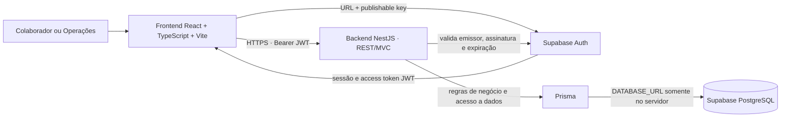

# Proposta de arquitetura — Emprest.AI

> Documento de proposta, não é ADR e não aprova decisões pendentes. A stack e o fluxo abaixo devem ser confirmados pelo time antes da implementação de autenticação, API ou banco.

## 1. O que os dados informados significam

- A URL do projeto e a chave `sb_publishable_...` identificam o projeto Supabase e inicializam um cliente Supabase. No frontend Vite, os nomes propostos são `VITE_SUPABASE_URL` e `VITE_SUPABASE_PUBLISHABLE_KEY`.
- A chave publishable é pública por natureza e pode ser incluída no bundle do navegador. Ela não identifica o usuário nem concede acesso irrestrito: o usuário é autenticado pelo Supabase Auth, e as políticas RLS controlam o acesso aos dados.
- Essa URL e essa chave não são credenciais de conexão PostgreSQL. Para Prisma acessar Postgres diretamente, o backend precisa de uma `DATABASE_URL` com credencial de banco, guardada somente no servidor.
- Nenhum valor de chave ou senha deve ser versionado neste documento ou no código.

## 2. Stack já registrada nos ADRs

- Frontend: React + TypeScript.
- Backend: NestJS + TypeScript, API REST com MVC.
- Persistência: Prisma e PostgreSQL hospedado no Supabase.
- Identidade/autorização: Supabase Auth e RLS/Supabase, ainda sem detalhamento do fluxo.
- Testes: Jest.
- Estratégia de migrations: não decidida.

O frontend já usa Vite para build, conforme a spec 001 de Login. Hospedagem e fluxo de deploy ainda não foram confirmados nos ADRs.

## 3. Arquitetura lógica proposta



### Responsabilidades

- **Frontend (`Empatricks.IA`)**: telas de Login, Catálogo, Meus empréstimos e Operações; mantém a sessão do usuário; chama o backend com o access token; nunca contém senha de banco ou chave Supabase secreta.
- **Backend (`Empatricks.IA.BACKS`)**: autentica cada chamada verificando o token Supabase; aplica autorização por papel e regras do PRD; executa operações de negócio; valida entradas; acessa PostgreSQL pelo Prisma.
- **Supabase Auth**: autentica usuários e emite tokens. A chave publishable é identidade da aplicação, não substitui login.
- **PostgreSQL/RLS**: mantém os dados e aplica uma segunda barreira de autorização. O papel e a identidade usados nas policies precisam vir de claims confiáveis, não de campos editáveis pelo cliente.
- **Prisma**: camada de persistência do backend. A credencial e o pool são configurados apenas no servidor.

## 4. Fluxos principais

### Login

1. A pessoa informa e-mail e senha no frontend.
2. O frontend autentica pelo Supabase Auth usando a URL e a chave publishable.
3. O Supabase devolve uma sessão com access token JWT.
4. O frontend envia o token ao backend nas chamadas REST. O backend valida assinatura, emissor e validade antes de processar a solicitação.

### Leitura e alteração de empréstimos

1. O frontend solicita Catálogo, Meus empréstimos ou operações ao backend.
2. O backend identifica a pessoa e o papel a partir de informação autenticada e confiável.
3. O backend aplica as regras do PRD: limite de três itens, prazo de 14 dias, bloqueio por atraso e indisponibilidade durante manutenção.
4. O Prisma executa a operação no PostgreSQL dentro do contexto de segurança aprovado.
5. O backend devolve apenas os dados permitidos ao papel e à pessoa autenticada.

## 5. Segurança necessária

- Manter `VITE_SUPABASE_URL` e `VITE_SUPABASE_PUBLISHABLE_KEY` no frontend; podem estar no bundle por serem valores publicáveis.
- Manter `DATABASE_URL` e qualquer credencial privilegiada apenas no backend, como variáveis server-side.
- Não usar chave secret/service-role no navegador. Essas chaves podem ignorar RLS.
- Não confiar em `user_metadata` editável pelo próprio usuário para conceder papel de Operações.
- Não presumir que RLS protege automaticamente consultas feitas pelo Prisma. Uma conexão direta do backend pode usar um papel PostgreSQL privilegiado que ignora RLS.
- Se NestJS + Prisma for o caminho de todas as consultas, definir e testar como o backend valida o JWT, como o contexto do usuário chega ao PostgreSQL e como cada transação executa sujeita a RLS. A conta usada pela aplicação não deve contornar policies sem uma decisão explícita e revisão de segurança.
- Não usar o banco remoto para desenvolvimento ou testes. Seguir `rules/migrations.md` e `rules/secrets.md`.

## 6. Responsabilidades de domínio previstas pelo PRD

Estas são áreas funcionais, não nomes ou contratos de módulos/rotas/tabelas já aprovados:

- autenticação e identificação de papéis;
- catálogo e estado de equipamentos;
- empréstimos e devoluções;
- operações de cadastro de equipamento e registro de devolução no balcão;
- aplicação das regras de limite, prazo, atraso e manutenção.

Os contratos REST, schema do banco, policies RLS e módulos NestJS devem ser definidos nas specs correspondentes antes de implementação.

## 7. Decisões que precisam do time

1. **Caminho das consultas de dados**
   - Opção A: navegador usa Supabase Data API diretamente com publishable key + sessão do usuário; RLS é aplicada diretamente por requisição. Definir qual papel o NestJS/Prisma terá nessa opção.
   - Opção B (proposta): navegador usa Supabase Auth para login e chama NestJS; NestJS usa Prisma no Postgres. Definir uma integração que preserve RLS por usuário, ou aprovar formalmente autorização no backend com RLS como camada adicional. Não assumir que uma conexão Prisma privilegiada preserva RLS.

2. **Fonte do papel Colaborador/Operações**
   - Opção A: claim de autorização em `app_metadata`, gerida apenas por processo administrativo confiável.
   - Opção B: associação de papel mantida em dados próprios e consultada pelo backend.
   - O time precisa definir quem concede/remove Operações e como revoga tokens quando o papel muda. Não usar metadados editáveis pelo usuário.

3. **Migrations e credenciais de schema**
   - Opção A: Prisma Migrate, coerente com o ORM registrado no ADR.
   - Opção B: Supabase CLI migrations, com Prisma usado para acesso à aplicação.
   - Escolher uma fonte de verdade para migrations antes de criar tabelas. As credenciais de migration devem ser separadas das credenciais de runtime.

4. **Hospedagem e ambientes**
   - Confirmar onde o backend NestJS será hospedado e como serão separados local, preview e production. Os IDs fornecidos anteriormente não substituem a configuração nem autorizam alteração nos projetos Vercel.

## 8. Configuração de ambiente proposta

Frontend local (`Empatricks.IA/.env.local`):

```dotenv
VITE_SUPABASE_URL=
VITE_SUPABASE_PUBLISHABLE_KEY=
```

Exemplo versionado (`Empatricks.IA/.env.example`): mesmos nomes, sem valores.

Backend local (`Empatricks.IA.BACKS/.env` ou `.env.local`, conforme configuração aprovada):

```dotenv
SUPABASE_URL=
DATABASE_URL=
```

Adicionar uma chave Supabase server-side somente se uma operação de servidor realmente precisar dela. Não prefixar variável secreta com `VITE_`. A variável de banco precisa de credencial PostgreSQL obtida no painel/Connect do Supabase; não é a chave publishable.

Configurar preview e production nos ambientes correspondentes apenas depois de confirmar hospedagem e autorização. Não alterei arquivos `.env` nem configurações remotas nesta proposta.

## 9. Próximo passo após aprovação

Transformar as decisões aprovadas em ADRs pelo time e em specs independentes para autenticação, catálogo, empréstimos/devoluções e operações. Cada mudança de schema precisa da aprovação prévia do DDL prevista em `rules/migrations.md`.

## Referências oficiais

- [Supabase API keys](https://supabase.com/docs/guides/getting-started/api-keys)
- [Supabase React quickstart](https://supabase.com/docs/guides/getting-started/quickstarts/reactjs)
- [Connecting to Postgres](https://supabase.com/docs/guides/database/connecting-to-postgres)
- [Row Level Security](https://supabase.com/docs/guides/database/postgres/row-level-security)
- [Supabase Prisma guide](https://supabase.com/docs/guides/database/prisma)
